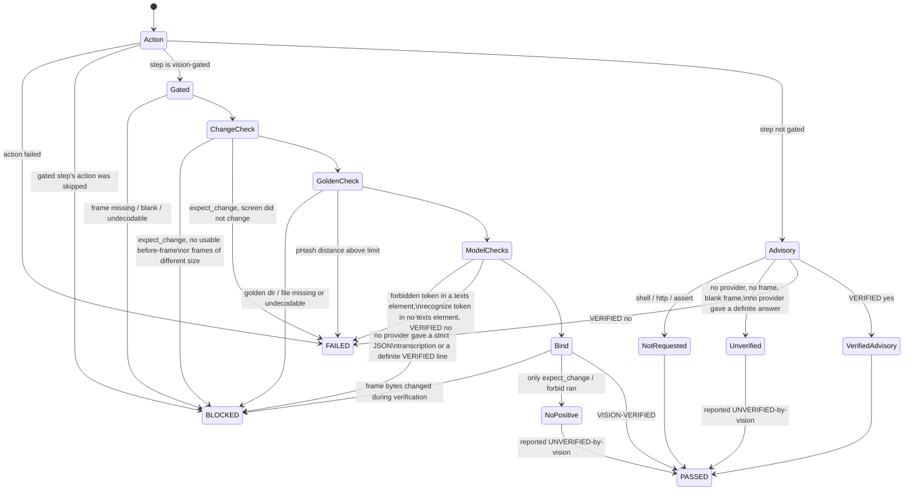

# No-bluff vision — how a structured step is judged

HelixQA's "eyes" must recognise real screen content, and a step must never
PASS on a vision answer nobody actually gave. This page is the reference
for how the structured executor (`pkg/autonomous`) judges a test-bank step
against its after-action screenshot, and how that verdict reaches the
report and the process exit code.

Code: `pkg/autonomous/vision_gate.go` (`judgeStep`),
`pkg/autonomous/structured_executor.go` (`verifyOutcome`, case verdicts),
`pkg/autonomous/pipeline.go` (`runStructuredPhase`,
`PipelineResult.ExitCode`), `pkg/testbank/schema.go` (bank keys),
`pkg/llm/vision_endpoint.go` (local endpoint). Gate tests:
`pkg/autonomous/no_bluff_vision*_test.go`,
`pkg/testbank/vision_fields_test.go`, `pkg/llm/vision_endpoint*_test.go`,
`pkg/orchestrator/aggregation_test.go`. Paired mutations:
`challenges/scripts/no_bluff_vision_mutation_challenge.sh`.

## Verdicts and exit code

| Case verdict | Meaning |
|---|---|
| PASSED | every executed step's action succeeded; every vision-gated step was executed (a gated step is never skipped) and every requested check positively succeeded on its bound frame; non-gated prose/placeholder steps may have been skipped |
| FAILED | an action failed, or a frame was read and contradicts the expectation |
| BLOCKED | the outcome could not be determined: a vision-gated step without a usable verdict, a gated step whose action had to be skipped (`playwright:` without a CDP URL), a capture problem (`frame_diff` on undecodable or differently sized frames, `expect_change` on non-comparable frames), or no executor for the platform (no device / display / browser) — never a pass, never an app defect |
| SKIPPED | bank placeholder / `requires_env` unset |

The structured outcome is stored on the session result
(`PipelineResult.Structured`, persisted in `pipeline-report.json` with every
case's verdict and every step's frame evidence). A BLOCKED case also files a
`Test Case BLOCKED (could not determine)` finding that names the cause. Its
category is **`environment`** (`FindingCategory.IsAppDefect()` is false): it
is never sent to bug reproduction, never ticketed, and not counted in
`issues_found`.

The bank runner (`helixqa run`, `pkg/orchestrator`) executes only `shell:`
steps on desktop. A case whose shell steps pass but which also has an
asserting step the runner cannot execute — a vision-gated step of any action
kind, or an `http:` / `tap:` / `frame_diff:` / `playwright:` / … action — is
an honest SKIPPED whose reason lists every such step as
`step <index> "<name>" (<action>[, vision-gated])` — never PASSED, and never
promoted to PASSED on crash-absence. A step pinned to another platform
(`platform:`) or explicitly skipped (`_skip: true`) is not this run's
assertion and does not stop the case.

## Exit-code contract (read this before wiring a script)

`helixqa autonomous` exits with `PipelineResult.ExitCode()`:

| Exit | Meaning | When |
|---|---|---|
| 0 | pass | no failure and no blocked case — including a session whose structured phase ran no case (it makes no structured claim) |
| 1 | **fail** | the session failed, or any structured case FAILED (a finding outranks could-not-determine) |
| 2 | **blocked / nothing passed** | any structured case BLOCKED; structured cases ran but none passed (e.g. all skipped); or the structured phase could not run its banks |

`helixqa run` (the bank runner) exits with `orchestrator.Result.ExitCode()`
on the same three values:

| Exit | Meaning | When |
|---|---|---|
| 0 | pass | every challenge executed and passed, no crash, no ANR |
| 1 | **fail** | any challenge failed / errored / timed out / stuck, or a crash or ANR was detected |
| 2 | **incomplete** | nothing failed, but not every challenge passed: nothing executed, or some/all challenges SKIPPED (e.g. a case whose vision-gated step the bank runner cannot execute); the summary line reads `INCOMPLETE - …` |

**Exit 2 is not a warning and not a pass.** A wrapper must branch on it.
Consumer scripts measured on 2026-10-14 in the catalogizer checkout
(`d211f574`; this repository does not edit them) and what to change:

| Script:line | Today | Change to |
|---|---|---|
| `scripts/helixqa-orchestrator.sh:314` (`if [[ $helixqa_rc -ne 0 ]]` → "HelixQA failed") | 1 and 2 both reported as "failed" | branch: `1` → failed; `2` → "BLOCKED / could not determine (see pipeline-report.json structured.cases)", also non-zero |
| `scripts/run-helixqa-all.sh:68` (`if "$HELIXQA_BIN" autonomous … \| tee` under `pipefail`) | 1 and 2 both land in the same failure branch | capture `${PIPESTATUS[0]}` and report 2 as BLOCKED, distinct from FAILED |
| `scripts/run-helixqa-web.sh:131-133` (`… \| tee … \|\| warn "…completed with warnings"`, then `ok "…complete"`) | 1 and 2 are swallowed as a warning and the run prints "complete" | stop treating non-zero as a warning: exit 1 = failed, exit 2 = blocked; never print "complete" for either |

**OPEN QUESTION for the operator:** a run whose structured cases were ALL
skipped (e.g. every case gated by `requires_env`) exits **2** ("nothing
passed"), not 0. That is the current decision (a skip is not a pass); if
all-skipped runs should exit 0 instead, it is a one-line change in
`StructuredExecutionResult.ExitCode` plus its tests — not made without a
decision.

## Bank keys (per step)

| Key | Effect | Needs a vision model |
|---|---|---|
| `vision_verify: true` | the model's reply must contain exactly one standalone line `VERIFIED: yes` (nothing else on that line) for the step's `expected` | yes |
| `recognize: [..]` | every token must appear, as whole normalised words, inside ONE element of the `texts` array of an expectation-blind JSON reading of the frame | yes |
| `forbid: [..]` | no token may appear in any `texts` element | yes |
| `golden: <id>` | the frame's 64-bit pHash must be within `phash_max_distance` of `<goldens dir>/<id>.png\|.jpg\|.jpeg` | no |
| `phash_max_distance: N` | 0..16, default 8; only valid with `golden` | no |
| `expect_change: true` | the after-frame must differ from the before-frame | no |

Any of these keys makes the step **vision-gated**. Load-time validation
(`TestCase.IsValid`) refuses:

- vision keys on a `shell:` / `http:` / `assert:` step (their verdict is an
  exit code or a response, not the screen), or on a prose/description step
  (including `# CONVERT:` placeholders) that the executor would skip;
- `expect_change` or `forbid` without a positive check (`vision_verify`,
  `recognize` or `golden`) — "something changed" (a crash dialog counts)
  and "no forbidden text" are not evidence of the expected screen;
- `phash_max_distance` without `golden` or outside 0..16 (two unrelated
  frames differ by ~32 of 64 bits);
- an empty (after normalisation) token, a token both recognized and
  forbidden, "no text" filler as a token (`no`, `none`, `n/a`, `nothing`,
  `empty`, …), and a `golden` id with path separators or `..`.

Normalisation: lower-case; every run of non-letter/non-digit characters
becomes one space. `"Sign-In!"` matches token `sign in`; token `error`
does NOT match `errors` or `terror`.

### What the model is asked

- `vision_verify`: the prompt asks for `VERIFIED: yes/no` and `ACTUAL: ...`.
  Only a line consisting of `VERIFIED: yes` or `VERIFIED: no` (optional full
  stop) is an answer; an echoed template (`VERIFIED: yes/no`),
  `UNVERIFIED: yes`, the phrase inside prose, or two answer lines are not.
- `recognize` / `forbid`: a separate expectation-BLIND prompt — it carries
  neither the expectation nor the tokens — asks for exactly one JSON object:

  ```json
  {"texts": ["each visible text string, verbatim, one per UI element"], "description": "free prose"}
  ```

  The local endpoint additionally receives
  `response_format: {"type": "json_object", "schema": {...}}` (the
  schema-constrained form documented for `/v1/chat/completions` in
  llama.cpp's `tools/server/README.md`); cloud providers keep their request
  shape. **Every** reply is strict-parsed: one object, exactly the keys
  `texts` (array of strings) and `description` (string), case-sensitive,
  each once, nothing before or after it. The only tolerated wrapper is a
  single code fence that is the whole reply (it cannot carry prose: the
  inside must still be the strict object). Anything else — the old
  `TEXT:`/`DESCRIPTION:` text, a heading of any style, an extra key, a
  `null` element, trailing commentary — is unusable: the next provider is
  asked, and if none qualifies the step is BLOCKED.

  Tokens are matched ONLY against individual `texts` elements, as whole
  normalised words within one element (elements are never joined, so a
  phrase cannot be assembled across two elements). The `description` is
  never consulted, so prose such as "the Login button is not shown" or
  "(no search bar visible)" cannot satisfy `recognize` nor trip `forbid`.
  Filler elements (`(none)`, `N/A`, `No text visible`, …) are dropped.
  There are no heading heuristics any more.

  **Residual limit:** the parser cannot tell whether the model obeyed the
  instruction to put only on-screen text in `texts`. A model that writes
  commentary INSIDE `texts` ("(no search bar visible)") has that string
  treated as screen text: it can satisfy `recognize` (a false pass) or trip
  `forbid` (a false fail). Pair `recognize` with `golden` (pHash against a
  reference screenshot) where a stable reference exists — that is the
  second, model-independent oracle.

### Which provider is asked

The structured executor expands an adaptive provider into its
vision-capable members and asks them in order — the operator-configured
`HELIX_VISION_ENDPOINT` provider first. A provider error, an empty or
ambiguous reply, or a blind reply that is not the strict JSON object moves on to the
next provider. A DEFINITE answer (`VERIFIED: yes` or `VERIFIED: no`) is
final: the next provider is never asked for a second opinion. When no
provider qualifies the step is BLOCKED and the reason names every provider
tried; the answering provider is recorded as `vision_provider`. Each member
is asked through its wrapper (`llm.VisionRouter.VisionVia`), so availability
marking, rate limiting, the circuit breaker and cost tracking still apply,
and no further provider is asked once the context is cancelled.

Goldens directory: `PipelineConfig.VisionGoldensDir`, else env
`HELIXQA_GOLDENS_DIR`. Neither set → a golden step is BLOCKED.

## Judging flow



## Frame binding (evidence)

Every step result records `frame_sha256` and `frame_phash` (16 hex digits)
of the exact after-action bytes the model saw, `before_frame_sha256`,
`golden_distance` (-1 when not compared), `vision_status`
(`verified` / `refuted` / `unverified` / `blocked` / `not_requested`),
`vision_reason`, `vision_provider` and, when requested, the blind
`vision_description`. The human-readable `actual` cites
`frame sha256:<12 hex> phash:<16 hex>`.

## Local vision model (OpenAI-compatible endpoint)

```bash
HELIX_VISION_ENDPOINT=http://127.0.0.1:8082/v1   # e.g. llmctl `vision`; `vision-pro` is :8083/v1
HELIX_VISION_MODEL=                              # optional; empty = "model" omitted, server uses the model it serves
HELIX_VISION_API_KEY=                            # optional; never logged
```

The endpoint joins the vision provider pool (`cmd/helixqa`) as provider
`vision-endpoint`, served by the OpenAI-style provider via its `BaseURL`
(`POST <endpoint>/chat/completions` with the frame as a PNG data URI),
with `temperature: 0` and a fixed `seed` so the same frame gets the same
answer. No `Authorization` header is sent when no key is set. Replies are
read up to 8 MiB (larger is refused) and error replies are quoted to 512
bytes. `HELIX_VISION_ENDPOINT` must be `http(s)://host[:port][/path]`:
user info, a query string or a fragment (where secrets get pasted) is
**refused at startup** with an error that does not echo the value — put a
key in `HELIX_VISION_API_KEY`. Transport errors are scrubbed to
`scheme://host/path` before they can reach a BLOCKED reason, a finding, the
report or stdout, and the request path is appended to the URL path. The
startup line prints `scheme://host/path`, the model, and
`api key: set|unset`. `HELIX_VISION_MODEL` is also read by the remote
Ollama auto-deploy (`HELIX_VISION_HOST`); set it to a name valid for
whichever you use.

## Impact on existing banks

Steps that already carried `vision_verify: true` were parsed but ignored
before; they are now gated. Measured on 2026-10-14 in the catalogizer
checkout: **27 `vision_verify: true` steps across 4 banks**
(`catalogizer-androidtv-executable.yaml` 9,
`catalogizer-androidtv-full-executable.yaml` 11,
`catalogizer-androidtv-comprehensive-executable.yaml` 5,
`catalogizer-web-comprehensive-executable.yaml` 2), on `screenshot` (26)
and `sleep` (1) steps. They load unchanged, but a run without a vision
provider that answers in the `VERIFIED:` format will now report those
cases BLOCKED (exit 2) where it previously reported PASSED.

## Honest boundary

- A vision model's answer is evidence about the frame it was shown, not
  proof the feature works end to end; pair it with deterministic checks
  (`golden`, `expect_change`, action assertions).
- The `texts` array is strict-parsed, but whether the model put only
  on-screen text in it is not checked: commentary written INSIDE `texts`
  is treated as screen text (a false `recognize` pass or a false `forbid`
  fail). A model that misses on-screen text produces a FAILED step. `golden`
  + pHash is the model-independent second oracle.
- `response_format` with a JSON schema is sent only to the local endpoint
  (llama-server); cloud providers are strict-parsed without it, so a cloud
  model that ignores the instruction is simply unusable (BLOCKED), never
  matched.
- `expect_change` and the `frame_diff` action use the same 17×17
  sampled-pixel comparison (≥1 % of sampled points differing by >30) on
  frames of equal size; undecodable or differently sized frames are not
  comparable — BLOCKED (environment) for both, never "motion" and never an
  app-defect finding. Consumer note: catalogizer's
  `challenges/helixqa-banks/catalogizer-androidtv-negative-paths-executable.yaml`
  uses `frame_diff: 2000` at lines 451 and 504 (measured at `d211f574`); a
  capture problem there now reports BLOCKED (exit 2) instead of FAILED.
- Secrets: `HELIX_VISION_ENDPOINT` with user info, a query, a fragment, an
  encoded `?`/`#` (`%3F`/`%23`) or a `;` parameter in the path is refused at
  startup without echoing it. A secret written as a plain path segment
  (`/key/<secret>/`) cannot be told from a real path and is NOT detected.
  Transport errors of every provider (OpenAI-style, anthropic, google,
  ollama, astica) are scrubbed to `scheme://host/path`; an error body is
  quoted up to 512 bytes with the provider's own API key replaced by
  `[REDACTED]`; any OTHER secret a server echoes in its body is not scrubbed.
- `IssuesFound` excludes environment findings at its call site; that call
  site is covered by reading, not by a mutant (reviewer mutant N23 —
  documented, not killed).
- The exit-code contracts are honoured by `cmd/helixqa`; no consumer script
  outside this repository was changed (see the table above).
- Non-gated steps keep their historic behaviour (an explicit
  `VERIFIED: no` still fails them); they are labelled honestly.
- No live run against a real llama-server was made while building this;
  the endpoint, its `response_format` and the JSON replies are exercised by
  an httptest server speaking the OpenAI chat-completions protocol.
