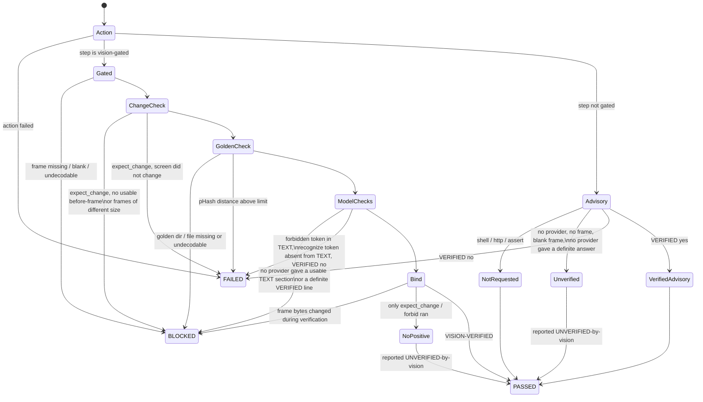

# No-bluff vision — how a structured step is judged

HelixQA's "eyes" must recognise real screen content, and a step must never
PASS on a vision answer nobody actually gave. This page is the reference
for how the structured executor (`pkg/autonomous`) judges a test-bank step
against its after-action screenshot, and how that verdict reaches the
report and the process exit code.

Code: `pkg/autonomous/vision_gate.go` (`judgeStep`),
`pkg/autonomous/structured_executor.go` (`verifyOutcome`, case verdicts),
`pkg/autonomous/pipeline.go` (`runStructuredPhase`,
`PipelineResult.ExitCode`), `pkg/testbank/schema.go` (bank keys),
`pkg/llm/vision_endpoint.go` (local endpoint). Gate tests:
`pkg/autonomous/no_bluff_vision*_test.go`,
`pkg/testbank/vision_fields_test.go`, `pkg/llm/vision_endpoint*_test.go`,
`pkg/orchestrator/aggregation_test.go`. Paired mutations:
`challenges/scripts/no_bluff_vision_mutation_challenge.sh`.

## Verdicts and exit code

| Case verdict | Meaning |
|---|---|
| PASSED | every step's action succeeded and, for a gated step, every requested check positively succeeded on the bound frame |
| FAILED | an action failed, or a frame was read and contradicts the expectation |
| BLOCKED | a vision-gated step's outcome could not be determined — never a pass |
| SKIPPED | bank placeholder / `requires_env` unset |

The structured outcome is stored on the session result
(`PipelineResult.Structured`, persisted in `pipeline-report.json` with every
case's verdict and every step's frame evidence). A BLOCKED case also files a
`Test Case BLOCKED (could not determine)` finding that names the cause.

`helixqa autonomous` exits with `PipelineResult.ExitCode()`:

| Exit | When |
|---|---|
| 1 | the session failed, or any structured case FAILED (a finding outranks could-not-determine) |
| 2 | any structured case BLOCKED; structured cases ran but none passed (e.g. all skipped); or the structured phase could not run its banks |
| 0 | otherwise — including a session whose structured phase ran no case (it makes no structured claim) |

## Bank keys (per step)

| Key | Effect | Needs a vision model |
|---|---|---|
| `vision_verify: true` | the model's reply must contain exactly one standalone line `VERIFIED: yes` (nothing else on that line) for the step's `expected` | yes |
| `recognize: [..]` | every token must appear, as a whole normalised word/phrase, in the `TEXT:` transcription of an expectation-blind reading of the frame | yes |
| `forbid: [..]` | no token may appear in that `TEXT:` transcription | yes |
| `golden: <id>` | the frame's 64-bit pHash must be within `phash_max_distance` of `<goldens dir>/<id>.png\|.jpg\|.jpeg` | no |
| `phash_max_distance: N` | 0..16, default 8; only valid with `golden` | no |
| `expect_change: true` | the after-frame must differ from the before-frame | no |

Any of these keys makes the step **vision-gated**. Load-time validation
(`TestCase.IsValid`) refuses:

- vision keys on a `shell:` / `http:` / `assert:` step (their verdict is an
  exit code or a response, not the screen);
- `expect_change` or `forbid` without a positive check (`vision_verify`,
  `recognize` or `golden`) — "something changed" (a crash dialog counts)
  and "no forbidden text" are not evidence of the expected screen;
- `phash_max_distance` without `golden` or outside 0..16 (two unrelated
  frames differ by ~32 of 64 bits);
- an empty (after normalisation) token, a token both recognized and
  forbidden, the prompt heading words `text` / `description` as tokens, and
  a `golden` id with path separators or `..`.

Normalisation: lower-case; every run of non-letter/non-digit characters
becomes one space. `"Sign-In!"` matches token `sign in`; token `error`
does NOT match `errors` or `terror`.

### What the model is asked

- `vision_verify`: the prompt asks for `VERIFIED: yes/no` and `ACTUAL: ...`.
  Only a line consisting of `VERIFIED: yes` or `VERIFIED: no` (optional full
  stop) is an answer; an echoed template (`VERIFIED: yes/no`),
  `UNVERIFIED: yes`, the phrase inside prose, or two answer lines are not.
- `recognize` / `forbid`: a separate expectation-BLIND prompt that carries
  neither the expectation nor the tokens asks for a `TEXT:` section
  (verbatim on-screen text) and a `DESCRIPTION:` section. Tokens are matched
  against the `TEXT:` section ONLY — the description is the model's own
  prose ("the Settings screen is not shown", "no error is visible") and
  never satisfies `recognize` nor trips `forbid`. A reply without a `TEXT:`
  section is not usable.

### Which provider is asked

The structured executor expands an adaptive provider into its
vision-capable members and asks them in order — the operator-configured
`HELIX_VISION_ENDPOINT` provider first. A provider error, an empty or
ambiguous reply, or a blind reply without a `TEXT:` section moves on to the
next provider. A DEFINITE answer (`VERIFIED: yes` or `VERIFIED: no`) is
final: the next provider is never asked for a second opinion. When no
provider qualifies the step is BLOCKED and the reason names every provider
tried; the answering provider is recorded as `vision_provider`.

Goldens directory: `PipelineConfig.VisionGoldensDir`, else env
`HELIXQA_GOLDENS_DIR`. Neither set → a golden step is BLOCKED.

## Judging flow



## Frame binding (evidence)

Every step result records `frame_sha256` and `frame_phash` (16 hex digits)
of the exact after-action bytes the model saw, `before_frame_sha256`,
`golden_distance` (-1 when not compared), `vision_status`
(`verified` / `refuted` / `unverified` / `blocked` / `not_requested`),
`vision_reason`, `vision_provider` and, when requested, the blind
`vision_description`. The human-readable `actual` cites
`frame sha256:<12 hex> phash:<16 hex>`.

## Local vision model (OpenAI-compatible endpoint)

```bash
HELIX_VISION_ENDPOINT=http://127.0.0.1:8082/v1   # e.g. llmctl `vision`; `vision-pro` is :8083/v1
HELIX_VISION_MODEL=                              # optional; empty = "model" omitted, server uses the model it serves
HELIX_VISION_API_KEY=                            # optional; never logged
```

The endpoint joins the vision provider pool (`cmd/helixqa`) as provider
`vision-endpoint`, served by the OpenAI-style provider via its `BaseURL`
(`POST <endpoint>/chat/completions` with the frame as a PNG data URI),
with `temperature: 0` and a fixed `seed` so the same frame gets the same
answer. No `Authorization` header is sent when no key is set. Replies are
read up to 8 MiB (larger is refused) and error replies are quoted to 512
bytes. The startup line prints `scheme://host/path` only (userinfo, query
and fragment redacted; an unparsable URL is not printed), the model, and
`api key: set|unset`. `HELIX_VISION_MODEL` is also read by the remote
Ollama auto-deploy (`HELIX_VISION_HOST`); set it to a name valid for
whichever you use.

## Impact on existing banks

Steps that already carried `vision_verify: true` were parsed but ignored
before; they are now gated. Measured on 2026-10-14 in the catalogizer
checkout: **27 `vision_verify: true` steps across 4 banks**
(`catalogizer-androidtv-executable.yaml` 9,
`catalogizer-androidtv-full-executable.yaml` 11,
`catalogizer-androidtv-comprehensive-executable.yaml` 5,
`catalogizer-web-comprehensive-executable.yaml` 2), on `screenshot` (26)
and `sleep` (1) steps. They load unchanged, but a run without a vision
provider that answers in the `VERIFIED:` format will now report those
cases BLOCKED (exit 2) where it previously reported PASSED.

## Honest boundary

- A vision model's answer is evidence about the frame it was shown, not
  proof the feature works end to end; pair it with deterministic checks
  (`golden`, `expect_change`, action assertions).
- `recognize` depends on the model transcribing the frame: a model that
  misses text that is on screen produces a FAILED step (token absent), not
  a pass; a model that writes no `TEXT:` section produces BLOCKED.
- `expect_change` uses the same 17×17 sampled-pixel comparison as the
  `frame_diff` action (≥1 % of sampled points differing by >30) on frames
  of equal size. The `frame_diff` action itself still treats undecodable or
  differently sized frames as "differ" — unchanged by this work.
- Non-gated steps keep their historic behaviour (an explicit
  `VERIFIED: no` still fails them); they are labelled honestly.
- No live run against a real llama-server was made while building this;
  the endpoint is exercised by an httptest server speaking the
  OpenAI chat-completions protocol.
