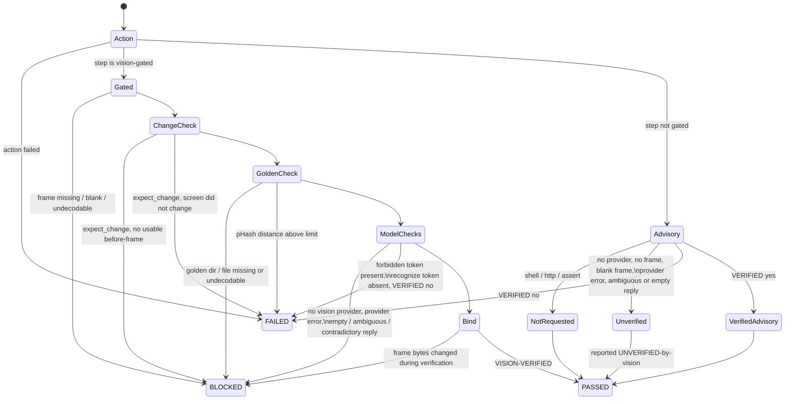

# No-bluff vision — how a structured step is judged

HelixQA's "eyes" must recognise real screen content, and a step must never
PASS on a vision answer nobody actually gave. This page is the reference
for how the structured executor (`pkg/autonomous`) judges a test-bank step
against its after-action screenshot.

Code: `pkg/autonomous/vision_gate.go` (`judgeStep`),
`pkg/testbank/schema.go` (bank keys), `pkg/llm/vision_endpoint.go`
(local endpoint). Gate: `pkg/autonomous/no_bluff_vision_test.go`.
Paired mutations: `challenges/scripts/no_bluff_vision_mutation_challenge.sh`.

## Verdicts

| Step result | Meaning | Exit-code semantic |
|---|---|---|
| PASSED | the action succeeded and, for a gated step, every requested check positively succeeded on the bound frame | 0 |
| FAILED | the action failed, or the frame was read and contradicts the expectation | 1 |
| BLOCKED | a vision-gated step whose outcome could not be determined | 2 — never a pass |
| SKIPPED | bank placeholder / `requires_env` unset | — |

A case that stops on a BLOCKED step is counted in
`StructuredExecutionResult.TestCasesBlocked`, files no defect ticket, and
`ExitCode()` returns 2 (a FAILED case anywhere outranks it with 1; a run
with no passed case is also 2).

## Bank keys (per step)

| Key | Effect | Needs a vision model |
|---|---|---|
| `vision_verify: true` | the model must answer exactly one `VERIFIED: yes` for the step's `expected` | yes |
| `recognize: [..]` | every token must appear, as a whole normalised word/phrase, in an expectation-BLIND description of the frame | yes |
| `forbid: [..]` | no token may appear in that blind description | yes |
| `golden: <id>` | the frame's 64-bit pHash must be within `phash_max_distance` of `<goldens dir>/<id>.png\|.jpg\|.jpeg` | no |
| `phash_max_distance: N` | 0..64, default 8; only valid with `golden` | no |
| `expect_change: true` | the after-frame must differ from the before-frame | no |

Any of these keys makes the step **vision-gated**. Load-time validation
refuses vacuous or contradictory use: `phash_max_distance` without
`golden` or outside 0..64, an empty (after normalisation) token, a token
both recognized and forbidden, a `golden` id with path separators or `..`.

Normalisation: lower-case; every run of non-letter/non-digit characters
becomes one space. `"Sign-In!"` matches token `sign in`; token `error`
does NOT match `errors` or `terror`.

The blind description prompt carries neither the expectation nor the
tokens, so the model cannot parrot them back.

Goldens directory: `PipelineConfig.VisionGoldensDir`, else env
`HELIXQA_GOLDENS_DIR`. Neither set → a golden step is BLOCKED.

## Judging flow



## Frame binding (evidence)

Every step result records `FrameSHA256` and `FramePHash` (16 hex digits)
of the exact after-action bytes the model saw, `BeforeFrameSHA256`,
`GoldenDistance` (-1 when not compared), `VisionStatus`
(`verified` / `refuted` / `unverified` / `blocked` / `not_requested`),
`VisionReason` and, when requested, the blind `VisionDescription`. The
human-readable `Actual` cites `frame sha256:<12 hex> phash:<16 hex>`.
`StructuredExecutionResult.Cases` keeps every case's verdict and step
results.

## Local vision model (OpenAI-compatible endpoint)

```bash
HELIX_VISION_ENDPOINT=http://127.0.0.1:8082/v1   # e.g. llmctl `vision`; `vision-pro` is :8083/v1
HELIX_VISION_MODEL=                              # optional; empty = server default
HELIX_VISION_API_KEY=                            # optional; never logged
```

The endpoint joins the vision provider pool (`cmd/helixqa`) as provider
`vision-endpoint`, served by the OpenAI-style provider via its `BaseURL`
(`POST <endpoint>/chat/completions` with the frame as a PNG data URI). No
`Authorization` header is sent when no key is set. The startup line prints
the URL (userinfo redacted), the model, and `api key: set|unset` only.
`HELIX_VISION_MODEL` is also read by the remote Ollama auto-deploy
(`HELIX_VISION_HOST`); set it to a name valid for whichever you use.

## Honest boundary

- A vision model's answer is evidence about the frame it was shown, not
  proof the feature works end to end; pair it with deterministic checks
  (`golden`, `expect_change`, `recognize`/`forbid`, action assertions).
- `recognize`/`forbid` depend on the model transcribing the frame; a weak
  model that misses text produces a FAILED step, not a pass.
- `expect_change` uses the same 17×17 sampled-pixel comparison as the
  `frame_diff` action (≥1 % of sampled points differing by >30).
- Non-gated steps keep their historic behaviour (an explicit
  `VERIFIED: no` still fails them); they are now labelled honestly.
