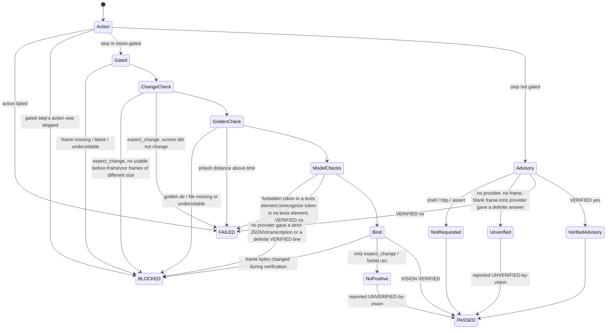

# No-bluff vision — how a structured step is judged

HelixQA's "eyes" must recognise real screen content, and a step must never
PASS on a vision answer nobody actually gave. This page is the reference
for how the structured executor (`pkg/autonomous`) judges a test-bank step
against its after-action screenshot, and how that verdict reaches the
report and the process exit code.

Code: `pkg/autonomous/vision_gate.go` (`judgeStep`),
`pkg/autonomous/structured_executor.go` (`verifyOutcome`, case verdicts),
`pkg/autonomous/pipeline.go` (`runStructuredPhase`,
`PipelineResult.ExitCode`), `pkg/testbank/schema.go` (bank keys),
`pkg/llm/vision_endpoint.go` (local endpoint). Gate tests:
`pkg/autonomous/no_bluff_vision*_test.go`,
`pkg/testbank/vision_fields_test.go`, `pkg/llm/vision_endpoint*_test.go`,
`pkg/orchestrator/aggregation_test.go`. Paired mutations:
`challenges/scripts/no_bluff_vision_mutation_challenge.sh`.

## Verdicts and exit code

| Case verdict | Meaning |
|---|---|
| PASSED | every executed step's action succeeded; every vision-gated step was executed (a gated step is never skipped) and every requested check positively succeeded on its bound frame; **no step was skipped** as not executable; **and at least one step OBSERVED app state** — a vision-confirmed screen, an `http:` response, an `assert:`, a `shell:` exit code / output, `playback_check:`, `frame_diff:`, or a `playwright:` `assertvisible` / `waitfor`. Input steps (`tap:`, `keypress:`, `text:`, `swipe:`, `adb_shell:`, other `playwright:` verbs) only report that the input was ACCEPTED, and `sleep:` / `screenshot` / prose observe nothing |
| FAILED | an action failed, or a frame was read and contradicts the expectation |
| BLOCKED | the outcome could not be determined — never a pass, never an app defect: a vision-gated step without a usable verdict; a gated step whose action had to be skipped (`playwright:` without a CDP URL); **no step observed app state**, or a step was **skipped as not executable** (the case was only partly run); the **session context ended** (timeout / cancel) before or during a step; a capture problem (`frame_diff` whose screenshot fails, whose frames are undecodable / differently sized, or **black** — every sampled channel ≤ 16: FLAG_SECURE / DRM surfaces, screen off; a uniform grey slate or a dark low-contrast scene is judged — `expect_change` on non-comparable frames, an ungated `screenshot` step whose capture failed); an Android-only action (`playback_check:`, `adb_shell:`) on a non-Android executor; no executor for the platform (no device / display / browser); a **configured device / display that is unreachable** (probed per platform: the last non-empty line of `adb get-state` must be `device`, desktop / web one real capture must succeed; a successful probe is cached, a failed one for 15 s; and after ANY device-action failure the probe is re-run uncached — when it fails the step is BLOCKED, when it succeeds the failure stands; the action's error text is never parsed); an `http:` step with **no base URL** configured (`HELIXQA_HTTP_BASE_URL` / `PipelineConfig.HTTPBaseURL`); an `assert:` with no `http:` step earlier in the SAME case (a bank defect). Host-only steps (`shell:`, `http:`, `assert:`, `sleep:`, not vision-gated) still run without an executor; `shell:` / `http:` / `assert:` decide on their own result, `sleep:` asserts nothing. |
| SKIPPED | bank placeholder / `requires_env` unset |

The structured outcome is stored on the session result
(`PipelineResult.Structured`, persisted in `pipeline-report.json` with every
case's verdict and every step's frame evidence). A BLOCKED case also files a
`Test Case BLOCKED (could not determine)` finding that names the cause. Its
category is **`environment`** (`FindingCategory.IsAppDefect()` is false): it
is never sent to bug reproduction, never ticketed, and not counted in
`issues_found`.

The bank runner (`helixqa run`, `pkg/orchestrator`) executes only `shell:`
steps on desktop. A case whose shell steps pass but which also has an
asserting step the runner cannot execute — a vision-gated step of any action
kind, or an `http:` / `tap:` / `frame_diff:` / `playwright:` / … action — is
an honest SKIPPED whose reason lists every such step as
`step <index> "<name>" (<action>[, vision-gated])` — never PASSED, and never
promoted to PASSED on crash-absence. A step pinned to another platform
(`platform:`) or explicitly skipped (`_skip: true`) is not this run's
assertion and does not stop the case.

## Exit-code contract (read this before wiring a script)

`helixqa autonomous` exits with `PipelineResult.ExitCode()`, except that a
session whose `pipeline-report.json` could not be written exits **2** when
it would otherwise exit 0 (a finding still exits 1):

| Exit | Meaning | When |
|---|---|---|
| 0 | pass | no failure and no blocked case — including a session whose structured phase ran no case (it makes no structured claim) |
| 1 | **fail** | any structured case FAILED (a finding outranks could-not-determine) |
| 2 | **blocked / nothing passed** | any structured case BLOCKED; structured cases ran but none passed (e.g. all skipped); the structured phase could not run its banks; or the **session itself was BLOCKED** (`status: blocked`): the preflight network / VPN check failed, the learn or plan phase failed (project unreadable, provider outage), the session timed out, or the session could not start (memory store) — none of these is a verdict about the app |

`helixqa run` (the bank runner) exits with `orchestrator.Result.ExitCode()`
on the same three values:

| Exit | Meaning | When |
|---|---|---|
| 0 | pass | every challenge executed and passed, no crash, no ANR |
| 1 | **fail** | any challenge failed / errored / timed out / stuck, or a crash or ANR was detected |
| 2 | **incomplete** | nothing failed, but not every challenge passed: nothing executed (including a bank that could not be loaded — missing file, malformed YAML), some/all challenges SKIPPED (e.g. a case whose vision-gated step the bank runner cannot execute; the summary line reads `INCOMPLETE - …`), or an error after execution began (the report could not be written; the run was cancelled or hit `--timeout`, also WHILE a platform ran) when no executed challenge failed |

An error raised after cases ran never erases their verdict: `orch.Run`
returns the result — including the partial result of a platform that was
cancelled mid-way — with the error, and a failed challenge / crash / ANR in
it still exits **1** (`error: … (exit 1)` plus the counts on stderr). A
challenge whose outcome the cancellation produced (an interrupted command,
a runner timeout) is recorded as SKIPPED "interrupted", never FAILED.

Both commands also use:

| Exit | When |
|---|---|
| 70 | an unrecovered Go panic in the main goroutine (internal HelixQA defect; stack on stderr) — never a verdict about the app |
| 1 (before anything runs) | CLI usage / configuration errors: missing `--banks`, a bad flag, invalid configuration, a refused `HELIX_VISION_ENDPOINT`; stderr starts with `error:`. This shares the value 1 with "fail" — distinguish by the `error:` line and by the absence of a report |

Residual: a panic in a goroutine other than the main one cannot be recovered
by `main`; Go's runtime then exits with status 2, which collides with
"blocked". The panic text on stderr distinguishes it.

**Exit 2 is not a warning and not a pass.** A wrapper must branch on it.
Consumer scripts measured on 2026-10-14 in the catalogizer checkout
(`d211f574`; this repository does not edit them) and what to change:

| Script:line | Today | Change to |
|---|---|---|
| `scripts/helixqa-orchestrator.sh:314` (`if [[ $helixqa_rc -ne 0 ]]` → "HelixQA failed") | 1 and 2 both reported as "failed" | branch: `1` → failed; `2` → "BLOCKED / could not determine (see pipeline-report.json structured.cases)", also non-zero |
| `scripts/run-helixqa-all.sh:68` (`if "$HELIXQA_BIN" autonomous … \| tee` under `pipefail`) | 1 and 2 both land in the same failure branch | capture `${PIPESTATUS[0]}` and report 2 as BLOCKED, distinct from FAILED |
| `scripts/run-helixqa-web.sh:131-133` (`… \| tee … \|\| warn "…completed with warnings"`, then `ok "…complete"`) | 1 and 2 are swallowed as a warning and the run prints "complete" | stop treating non-zero as a warning: exit 1 = failed, exit 2 = blocked; never print "complete" for either |

**OPEN QUESTION for the operator:** a run whose structured cases were ALL
skipped (e.g. every case gated by `requires_env`) exits **2** ("nothing
passed"), not 0. That is the current decision (a skip is not a pass); if
all-skipped runs should exit 0 instead, it is a one-line change in
`StructuredExecutionResult.ExitCode` plus its tests — not made without a
decision.

## Bank keys (per step)

| Key | Effect | Needs a vision model |
|---|---|---|
| `vision_verify: true` | the model's reply must contain exactly one standalone line `VERIFIED: yes` (nothing else on that line) for the step's `expected` | yes |
| `recognize: [..]` | every token must EQUAL one whole element (after normalisation) of the `texts` array of an expectation-blind JSON reading of the frame | yes |
| `recognize_exact: true` | states the default explicitly; only valid with `recognize` | — |
| `recognize_contains: true` | opt-in: a token may appear as whole normalised words INSIDE one element (negations / commentary inside an element then match — use only for tokens that are part of longer on-screen strings); only valid with `recognize`, contradicts `recognize_exact` | — |
| `forbid: [..]` | a token PRESENT in any `texts` element fails the step; its ABSENCE is credited only when the same reading matched every `recognize` token (a positive anchor), so `forbid` requires `recognize` | yes |
| `golden: <id>` | the frame's 64-bit pHash must be within `phash_max_distance` of `<goldens dir>/<id>.png\|.jpg\|.jpeg` | no |
| `phash_max_distance: N` | 0..16, default 8; only valid with `golden` | no |
| `expect_change: true` | the after-frame must differ from the before-frame | no |

Any of these keys makes the step **vision-gated**. Load-time validation
(`TestCase.IsValid`) refuses:

- vision keys on a `shell:` / `http:` / `assert:` step (their verdict is an
  exit code or a response, not the screen), or on a prose/description step
  (including `# CONVERT:` placeholders) that the executor would skip;
- `expect_change` or `forbid` without a positive check (`vision_verify`,
  `recognize` or `golden`) — "something changed" (a crash dialog counts)
  and "no forbidden text" are not evidence of the expected screen;
- `phash_max_distance` without `golden` or outside 0..16 (two unrelated
  frames differ by ~32 of 64 bits);
- `forbid` without `recognize` (absence is only credible next to a positive
  anchor in the same reading);
- an empty (after normalisation) token, a token both recognized and
  forbidden, "no text" filler as a token (`no`, `none`, `n/a`, `nothing`,
  `empty`, …), and a `golden` id with path separators or `..`.

Normalisation: lower-case; every run of characters that are not letters,
digits or combining marks becomes one space. `"Sign-In!"` matches token
`sign in`; token `error` does NOT match `errors` or `terror`. Combining
marks (Mn / Mc) are part of the word — a Devanagari or Thai vowel sign
changes it (`काल` is not `कल`) — except the optional Arabic harakat and
Hebrew niqqud, which are dropped (`كَتَبَ` matches `كتب`).

### What the model is asked

- `vision_verify`: the prompt asks for `VERIFIED: yes/no` and `ACTUAL: ...`.
  Only a line consisting of `VERIFIED: yes` or `VERIFIED: no` (optional full
  stop) is an answer; an echoed template (`VERIFIED: yes/no`),
  `UNVERIFIED: yes`, the phrase inside prose, or two answer lines are not.
  The reply must have exactly that shape: every non-blank line is the one
  answer line or ONE `ACTUAL: …` line. Any other line — a refusal
  ("I cannot view images."), a conditional ("If … I would answer:"), a
  retraction ("Wait, no."), a second verdict inside prose, a filled
  template followed by "the screen does not match", a code fence — makes
  the reply ambiguous: next provider, else BLOCKED. Multi-line `ACTUAL`
  descriptions are ambiguous (recall cost). The ACTUAL text itself is
  scanned: a second
  verdict (`verified: …`) or the model saying it could not see / read the
  image ("I cannot see the image", "unable to view images; assuming yes")
  makes the reply ambiguous too. Residual: a plain contradiction in the
  ACTUAL text ("the settings screen is NOT shown") is not understood, so
  `VERIFIED: yes` next to it is honoured.
- `recognize` / `forbid`: a separate expectation-BLIND prompt — it carries
  neither the expectation nor the tokens — asks for exactly one JSON object:

  ```json
  {"texts": ["each visible text string, verbatim, one per UI element"], "description": "free prose"}
  ```

  The local endpoint additionally receives
  `response_format: {"type": "json_object", "schema": {...}}` (the
  schema-constrained form documented for `/v1/chat/completions` in
  llama.cpp's `tools/server/README.md`); cloud providers keep their request
  shape. **Every** reply is strict-parsed: one object, exactly the keys
  `texts` (array of strings) and `description` (string), case-sensitive,
  each once, nothing before or after it. The only tolerated wrapper is a
  single code fence that is the whole reply (it cannot carry prose: the
  inside must still be the strict object). Anything else — the old
  `TEXT:`/`DESCRIPTION:` text, a heading of any style, an extra key, a
  `null` element, trailing commentary — is unusable: the next provider is
  asked, and if none qualifies the step is BLOCKED.

  Tokens are matched ONLY against individual `texts` elements, as whole
  normalised words within one element (elements are never joined, so a
  phrase cannot be assembled across two elements). Further limits — each
  makes the whole reply unusable: invalid UTF-8; more than 2000 elements;
  an element longer than 200 characters; an element containing a line
  break, a control character or a line / paragraph separator (U+2028 /
  U+2029) (one element per UI element; recall cost: a multi-line label must
  be transcribed as separate elements). Verdict order: a `forbid` token
  PRESENT in any element fails the step first, whatever else the reading
  holds (real copy such as "Unable to process image" next to a refusal
  included). Claims of ABSENCE need a usable reading: one that holds
  **no screen text** (empty `texts`, or filler only), or in which
  **EVERY** element is the model talking — a refusal or a remark about the
  image ("I'm sorry, I can't …", "I apologize, but I cannot …", "I cannot
  see …", "Unable to read the text in this image", "As an AI …",
  "The image is …") — is unusable: the next provider is asked, else
  BLOCKED. The decision is structural: a refusal-looking element NEXT TO
  other screen text is treated as screen text (real app copy such as
  "As an AI developer tool …"). A `forbid` absence is credited only when
  every `recognize` token matched in the same reading (the positive
  anchor), so a refusal in words no phrase list knows cannot pass as a
  screen without the forbidden text. A recognize token found only INSIDE
  a longer element (`Sign In` in `Sign In to Catalogizer`) is BLOCKED with
  a pointer to `recognize_contains`, never filed as an app defect. Normalisation applies NFKC (fullwidth
  letters, ligatures, mathematical alphanumerics fold to plain letters)
  and drops Unicode format characters (Cf: zero-width space / joiner, BOM,
  soft hyphen, tag characters) and the other invisible code points —
  Other_Default_Ignorable_Code_Point (combining grapheme joiner U+034F,
  Hangul fillers U+115F / U+1160 / U+3164 / U+FFA0, Khmer U+17B4 / U+17B5)
  and Variation_Selector (U+FE00..U+FE0F, U+E0100..U+E01EF, Mongolian
  U+180B..U+180F) — so none can split or disguise a token. By default a
  recognize token must EQUAL one whole element after normalisation, so
  commentary such as "(no Login button visible)" or "Login not visible"
  cannot satisfy `recognize: [Login]` (`recognize_contains: true` restores
  contained-words matching). The `description` is
  never consulted, so prose such as "the Login button is not shown" or
  "(no search bar visible)" cannot satisfy `recognize` nor trip `forbid`.
  Filler elements (`(none)`, `N/A`, `No text visible`, …) are dropped.
  There are no heading heuristics any more.

  **Residual limit:** the parser cannot tell whether the model obeyed the
  instruction to put only on-screen text in `texts`. An all-refusal reading
  is recognised by a phrase list (a heuristic): a refusal in other wording
  ("Lo siento, no puedo …") with a recognize token missing is REFUTED (a
  false FAIL, never a false pass — the forbid anchor rule still blocks an
  absence claim); a PARTIAL refusal next to real text ("Library",
  "I'm sorry, I can't identify the rest") is treated as screen text, so a
  forbidden token in the unread part is not seen. Other commentary written
  INSIDE `texts` is treated as screen text: with `recognize_contains` it
  can satisfy `recognize` (a false pass); it can trip `forbid` (a false
  fail). Pair `recognize` with `golden` (pHash against a
  reference screenshot) where a stable reference exists — that is the
  second, model-independent oracle.

### Which provider is asked

The structured executor expands an adaptive provider into its
vision-capable members and asks them in order — the operator-configured
`HELIX_VISION_ENDPOINT` provider first. A provider error, an empty or
ambiguous reply, or a blind reply that is not the strict JSON object moves on to the
next provider. A DEFINITE answer (`VERIFIED: yes` or `VERIFIED: no`) is
final: the next provider is never asked for a second opinion. When no
provider qualifies the step is BLOCKED and the reason names every provider
tried; the answering provider is recorded as `vision_provider`. Each member
is asked through its wrapper (`llm.VisionRouter.VisionVia`), so availability
marking, rate limiting, the circuit breaker and cost tracking still apply,
and no further provider is asked once the context is cancelled.

Goldens directory: `PipelineConfig.VisionGoldensDir`, else env
`HELIXQA_GOLDENS_DIR`. Neither set → a golden step is BLOCKED.

## Judging flow



The diagram is per step. At case level, a case whose executed steps all
PASSED but none of which OBSERVED app state (only input / `sleep:` /
`screenshot` / prose steps, or screens no model confirmed), or one of whose
steps was skipped as not executable, is BLOCKED, not PASSED.

## Frame binding (evidence)

Every step result records `frame_sha256` and `frame_phash` (16 hex digits)
of the exact after-action bytes the model saw, `before_frame_sha256`,
`golden_distance` (-1 when not compared), `vision_status`
(`verified` / `refuted` / `unverified` / `blocked` / `not_requested`),
`vision_reason`, `vision_provider` and, when requested, the blind
`vision_description`. The human-readable `actual` cites
`frame sha256:<12 hex> phash:<16 hex>`.

## Local vision model (OpenAI-compatible endpoint)

```bash
HELIX_VISION_ENDPOINT=http://127.0.0.1:8082/v1   # e.g. llmctl `vision`; `vision-pro` is :8083/v1
HELIX_VISION_MODEL=                              # optional; empty = "model" omitted, server uses the model it serves
HELIX_VISION_API_KEY=                            # optional; never logged
```

The endpoint joins the vision provider pool (`cmd/helixqa`) as provider
`vision-endpoint`, served by the OpenAI-style provider via its `BaseURL`
(`POST <endpoint>/chat/completions` with the frame as a PNG data URI),
with `temperature: 0` and a fixed `seed` so the same frame gets the same
answer. No `Authorization` header is sent when no key is set. Replies are
read up to 8 MiB (larger is refused) and error replies are quoted to 512
bytes. `HELIX_VISION_ENDPOINT` must be `http(s)://host[:port][/path]`:
user info, a query string or a fragment (where secrets get pasted) is
**refused at startup** with an error that does not echo the value — put a
key in `HELIX_VISION_API_KEY`. Transport errors are scrubbed to
`scheme://host/path` before they can reach a BLOCKED reason, a finding, the
report or stdout, and the request path is appended to the URL path. The
startup line prints `scheme://host/path`, the model, and
`api key: set|unset`. `HELIX_VISION_MODEL` is also read by the remote
Ollama auto-deploy (`HELIX_VISION_HOST`); set it to a name valid for
whichever you use.

## Impact on existing banks

Steps that already carried `vision_verify: true` were parsed but ignored
before; they are now gated. Measured on 2026-10-14 in the catalogizer
checkout: **27 `vision_verify: true` steps across 4 banks**
(`catalogizer-androidtv-executable.yaml` 9,
`catalogizer-androidtv-full-executable.yaml` 11,
`catalogizer-androidtv-comprehensive-executable.yaml` 5,
`catalogizer-web-comprehensive-executable.yaml` 2), on `screenshot` (26)
and `sleep` (1) steps. They load unchanged, but a run without a vision
provider that answers in the `VERIFIED:` format will now report those
cases BLOCKED (exit 2) where it previously reported PASSED.

Round 6 (re-measured 2026-10-14, same checkout, 15 banks / 1269 cases, all
loading): none of those 27 steps uses `recognize` / `forbid`, so the
exact-by-default `recognize` change does not touch them. With no executor,
no `HELIXQA_HTTP_BASE_URL` and no vision provider (83 cases with `shell:` /
`adb_shell:` / `playwright:` steps or `requires_env` excluded), the
structured executor now reports **0 PASSED, 0 FAILED, 1186 BLOCKED**; the
12 cases that used to PASS there were sleep-only or sleep + prose cases
(e.g. `android-home-loads`, which is also BLOCKED with a device attached
because its only other step is unconverted prose).

Round 7 (re-measured 2026-10-14 with a FAKE device that accepts every input
and shows a static noise image — no app on it — and no vision provider,
`shell:` / `adb_shell:` / `playwright:` / `requires_env` cases excluded as
before): catalogizer 15 banks / 1269 cases **0 PASSED** (was 313: tap /
keypress / text-only cases such as `android-login-success`, whose
"Verify session" step is an unconverted TODO), 351 BLOCKED, 835 SKIPPED;
boba 7 banks / 61 cases 0 PASSED; this repository's `banks/` 145 files /
2873 cases 0 PASSED (was 203). Every bank still loads; none uses
`recognize` / `forbid`, so the new `forbid`-needs-`recognize` load rule
breaks none of them.

## Honest boundary

- A vision model's answer is evidence about the frame it was shown, not
  proof the feature works end to end; pair it with deterministic checks
  (`golden`, `expect_change`, action assertions).
- The `texts` array is strict-parsed, but whether the model put only
  on-screen text in it is not checked: commentary written INSIDE `texts`
  is treated as screen text (a false `recognize` pass or a false `forbid`
  fail). A model that misses on-screen text produces a FAILED step. `golden`
  + pHash is the model-independent second oracle.
- `response_format` with a JSON schema is sent only to the local endpoint
  (llama-server); cloud providers are strict-parsed without it, so a cloud
  model that ignores the instruction is simply unusable (BLOCKED), never
  matched.
- `expect_change` and the `frame_diff` action use the same 17×17
  sampled-pixel comparison (≥1 % of sampled points differing by >30) on
  frames of equal size; undecodable or differently sized frames are not
  comparable — BLOCKED (environment) for both, never "motion" and never an
  app-defect finding. Consumer note: catalogizer's
  `challenges/helixqa-banks/catalogizer-androidtv-negative-paths-executable.yaml`
  uses `frame_diff: 2000` at lines 451 and 504 (measured at `d211f574`); a
  capture problem there now reports BLOCKED (exit 2) instead of FAILED.
- A case PASSes only when a step OBSERVED app state (see the verdict
  table). "Observed" is decided by the action kind and the vision status:
  a `shell:` exit code counts even when the command checks nothing about
  the app, and an `http:` step counts on its expected status / body checks.
- Reachability: both production executor factories probe each platform
  (last `adb -s <serial> get-state` line must be `device`; desktop / web
  one real capture); `cli` / `api` platforms are not probed and the web
  probe starts the browser. A device action that fails while the device
  still probes reachable is a FAILED step (a device that drops between the
  failure and the re-probe is reported unreachable).
- The run's cancellation / timeout: `helixqa run` keeps the challenges a
  platform already ran (a FAILED one exits 1) and records a challenge cut
  by the cancellation as SKIPPED "interrupted" (exit 2 when nothing
  failed); the structured executor BLOCKS every step once the session
  context ended.
- Secrets: `HELIX_VISION_ENDPOINT` with user info, a query (also a bare
  `?`), a fragment (also a bare `#`), an encoded `?`/`#` (`%3F`/`%23`) or a
  `;` parameter in the path is refused at startup without echoing it. A
  secret written as a plain path segment (`/key/<secret>/`) cannot be told
  from a real path and is NOT detected. Every provider (OpenAI-style,
  anthropic, google, ollama, astica) reads replies through one helper:
  the read is capped at 8 MiB (+1 byte, over-cap success bodies refused);
  an error body (and astica's non-success `status` text) has the
  provider's own API key redacted in the FULL body FIRST — raw, any letter
  case, URL query/path-escaped, every byte percent-encoded, hex, JSON
  `\uXXXX` escapes, base64 (std/URL, padded/raw) of the key alone, and the
  key INSIDE a larger base64 blob at each of the three byte alignments
  (e.g. an echoed `Authorization: Bearer <key>` header; up to 2 key bytes
  remain in the partial characters at each edge) — and is only THEN
  truncated to 512 bytes. NOT detected: mixed or partial escaping, a
  partial echo of the key (e.g. its first 34 of 46 characters), base64
  wrapped into lines (MIME, 76 columns) or of a UTF-16 encoding, HTML
  entities, and other encodings (base32, compression, reversal). Keys shorter than 8
  characters are not redacted (they would match ordinary text). Any OTHER
  secret a server echoes (another credential, a cookie) is not scrubbed.
  Transport errors are scrubbed to `scheme://host/path`.
- Unicode: NFKC and format-character folding do NOT map cross-script
  homoglyphs (a Cyrillic `о` in `Lоgin` stays different from Latin `o`):
  that needs Unicode TS #39 confusable skeletons, which are not
  implemented. A forbid token disguised with homoglyphs is not detected.
- `IssuesFound` excludes environment findings at its call site; that call
  site is covered by reading, not by a mutant (reviewer mutant N23 —
  documented, not killed).
- The exit-code contracts are honoured by `cmd/helixqa`; no consumer script
  outside this repository was changed (see the table above).
- Non-gated steps keep their historic behaviour (an explicit
  `VERIFIED: no` still fails them); they are labelled honestly.
- No live run against a real llama-server was made while building this;
  the endpoint, its `response_format` and the JSON replies are exercised by
  an httptest server speaking the OpenAI chat-completions protocol.
